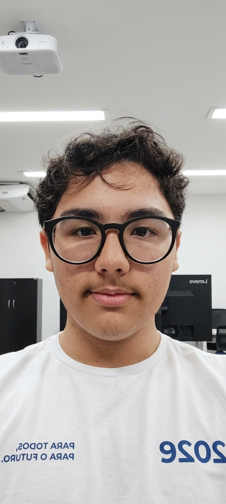

# 🛠️ Sistema de Mapeamento e Localização Rápida de Ativos — Vale


Projeto desenvolvido para o **Desafio 07 — Vale**, focado no mapeamento e rastreamento em tempo real de ferramentas, peças de reposição e insumos industriais nos almoxarifados e pátios operacionais da Vale.

---

## 📌 Sumário

- [Visão Geral](#-visão-geral)
- [Funcionalidades Principais](#-funcionalidades-principais)
- [Páginas do Sistema](#-páginas-do-sistema)
- [Tecnologias e Padrões Utilizados](#-tecnologias-e-padrões-utilizados)
- [Acessibilidade e Responsividade](#-acessibilidade-e-responsividade)
- [Estrutura de Arquivos](#-estrutura-de-arquivos)
- [Como Executar o Projeto](#-como-executar-o-projeto)
- [Equipe de Desenvolvimento](#-equipe-de-desenvolvimento)

---

## 🔍 Visão Geral

Nas operações industriais da Vale, a agilidade na localização de insumos e ferramentas é crítica para evitar paradas não programadas e otimizar o tempo das equipes de manutenção.

Este projeto entrega um painel corporativo responsivo, acessível e intuitivo que permite consultar a posição física exata (Galpão, Armário, Prateleira), verificar o estado atual (Disponível, Em Uso, Manutenção) e realizar leituras rápidas via código de barras ou QR Code.

---

## ⚡ Funcionalidades Principais

- **Consulta Instantânea:** Busca rápida por nome, código de patrimônio (`PAT-XXXX`) ou categoria do ativo.
- **Leitor de Código / QR Code:** Interface simulada para escaneamento direto com a câmera do dispositivo móvel.
- **Painel de Inventário Rápido:** Indicadores agregados sobre a disponibilidade dos itens em tempo real.
- **Histórico de Movimentações:** Rastreabilidade completa de saídas, devoluções e envios para manutenção com registro de responsável.
- **Menu Hambúrguer 100% CSS:** Navegação fluida em dispositivos móveis sem dependências externas de JavaScript.

---

## 🌐 Páginas do Sistema

| Página | Arquivo | Descrição |
| :--- | :--- | :--- |
| **Início** | `home.html` | Dashboard principal com busca rápida, mapa conceitual e indicadores do almoxarifado. |
| **Pesquisar** | `pesquisar.html` | Consulta avançada de ativos filtrando por categorias e posições físicas. |
| **Leitura de Código** | `leitura.html` | Leitor óptico/câmera para identificação rápida no campo. |
| **Histórico** | `historico.html` | Log auditável de transações e movimentações dos itens. |
| **Sobre** | `sobre.html` | Apresentação da equipe de desenvolvimento e competências técnicas. |
| **Ajuda** | `ajuda.html` | Central de suporte e FAQs do sistema. |

---

## 🛠️ Tecnologias e Padrões Utilizados

- **HTML5 Semântico:** Uso correto de tags `<header>`, `<nav>`, `<main>`, `<section>`, `<article>`, `<aside>` e `<footer>` garantindo boa estrutura de código e SEO.
- **CSS3 Flexbox Layout:** Design adaptável e estruturado para múltiplos tamanhos de tela.
- **Design System Vale:**
  - `Verde Institucional Vale`: `#007E7A`
  - `Amarelo Ouro Vale`: `#ECB11F`
  - `Grafite Escuro`: `#212529`
  - Typography: Fontes *Inter* (corpo) e *Roboto* (títulos).
- **Micro-interações:** Transições suaves ajustadas em tempo limite de **350ms** para máxima usabilidade.

---

## ♿ Acessibilidade e Responsividade

- **Responsividade Total:** Suporte nativo para dispositivos móveis a partir de **360px** de largura até monitores *Ultra-Wide*.
- **Acessibilidade Teclado/Leitores:**
  - Estados `:focus-visible` destacados em amarelo ouro (`--color-secondary`) para navegação facilitada via tecla `Tab`.
  - Atributos ARIA (`aria-label`, `aria-current="page"`) devidamente mapeados nas navegações.
- **Visual Feedback:** Destaque visual individual da aba ativa correspondente à página atual.

---

## 📁 Estrutura de Arquivos

```text
.
├── home.html        # Página Inicial / Dashboard
├── pesquisar.html   # Consulta Geral de Ativos
├── leitura.html     # Leitor de QR Code / Código PAT
├── historico.html   # Log de Movimentações
├── sobre.html       # Página da Equipe
├── ajuda.html       # Suporte e Dúvidas Frequentes
├── style.css        # CSS Unificado & Design System
├── imgyuri.jpg      # Foto Integrante Yuri
├── imgfilipe.jpg    # Foto Integrante Filipe
└── README.md        # Documentação do Projeto
```

---

## 🚀 Como Executar o Projeto

1. **Clonar ou Baixar o Repositório:**
   ```bash
   git clone https://github.com/usuario/desafio-vale-ativos.git
   ```
2. **Navegar até a pasta do projeto:**
   ```bash
   cd desafio-vale-ativos
   ```
3. **Abrir no navegador:**
   - Basta dar um duplo clique no arquivo `home.html` ou abrir através da extensão *Live Server* no VS Code.

---

## 👥 Equipe de Desenvolvimento

Projeto desenvolvido pelos alunos para atendimento dos requisitos das Unidades Curriculares **UC7** e **UC14**:

| Foto | Integrante | Função | Perfil Social |
| :---: | :--- | :--- | :---: |
|  | **Yuri Honorato** | Back-end Developer | [Instagram](https://www.instagram.com/strm.yuri?obrf=MWF0MWQ2czR4MTJveQ==) |
|  | **Filipe** | Front-end Developer | [Instagram](https://www.instagram.com/rodriguesfilipemartins?dlrf=d2RjcDg1OTJhOHR1) |

---

<p center align="center">
  <small>&copy; 2026 Sistema de Localização de Ativos — Desafio 07 (Vale) | UC7 & UC14</small>
</p>